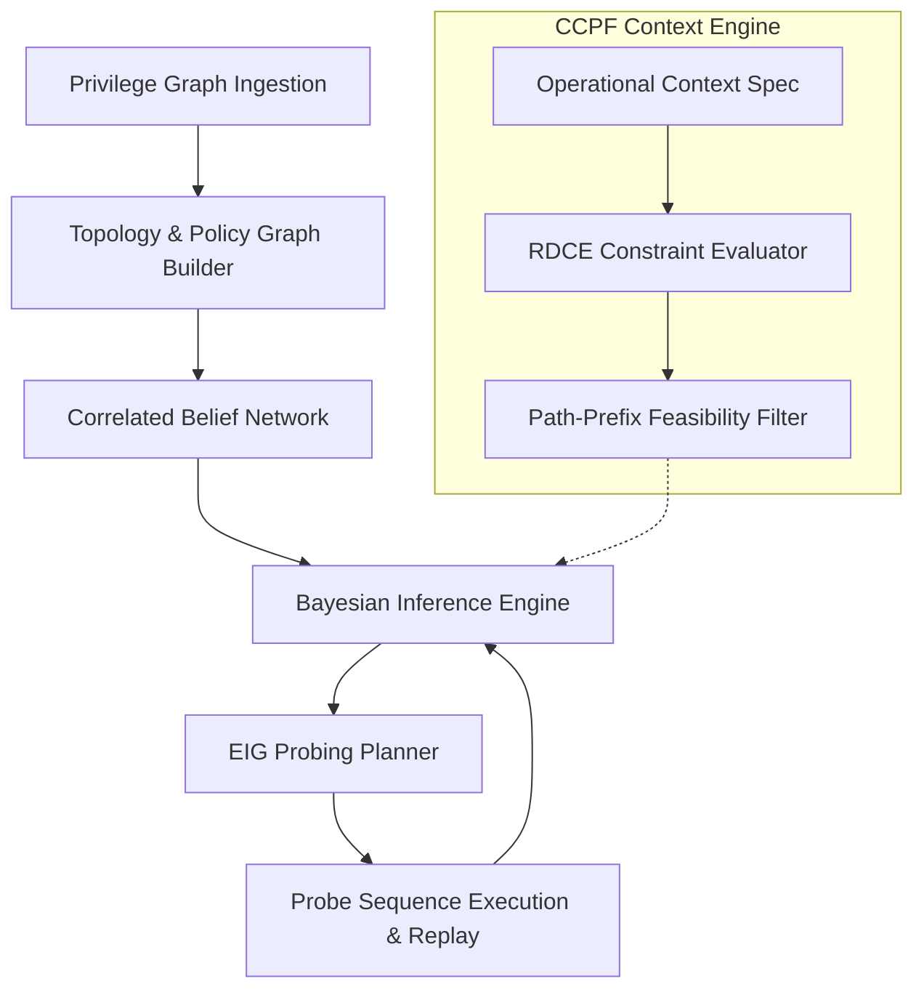

# ARF-RT Architecture Specification

## 1. Overview

**ARF-RT (Attack Path Risk Topology - Risk Reasoning Engine)** is an advanced Bayesian framework designed for cloud identity attack path modeling, structural dependency analysis, and active hypothesis testing.

Unlike static reachability graphs that assume identity traversal edges are conditionally independent, ARF-RT models:
1. **Structural Correlations:** Multiple edges sharing identical Service Control Policies (SCPs), permission boundaries, or AWS Organization restrictions fail jointly.
2. **Bayesian Belief Networks:** Observation of one edge immediately updates belief across all topologically dependent paths.
3. **Entropy-Guided Active Probing (EIG):** Optimal probe recommendations using Expected Information Gain to minimize path viability uncertainty in minimal probe steps.
4. **Context-Conditioned Path Feasibility (CCPF):** Formal constraint-satisfaction pre-filtering of operational prerequisites (e.g. source CIDR, MFA session state, tag invariants) without biasing probabilistic scores.

---

## 2. Core Subsystems

### 2.1 Privilege Graph Ingestion & Adapters
- **PMapper Adapter:** Converts AWS IAM Principal Mapper nodes and edges into internal canonical structures.
- **AWS Organizations Adapter:** Parses organizational hierarchies, Organizational Units (OUs), and attached SCP policy documents.

### 2.2 Belief Representation & Correlation
- **Belief State (`arf_rt.engine.belief`):** Represents probability mass functions over privilege edge traversal states $\{0, 1\}$.
- **Structural Grouping (`arf_rt.engine.correlation`):** Clusters edges guarded by common policy primitives into correlated risk blocks to avoid probability overestimation.

### 2.3 Information-Theoretic Planner
- Computes Shannon entropy over candidate attack paths to target resources.
- Evaluates Expected Information Gain:
  $$\text{EIG}(e) = H(\mathcal{P}) - \sum_{o \in \{0, 1\}} P(e=o) H(\mathcal{P} \mid e=o)$$
- Selects top probes guaranteed to collapse uncertainty fastest.

### 2.4 Context-Conditioned Path Feasibility (CCPF)
- Operates as a declarative constraint evaluation system.
- Evaluates context constraints (CIDR ranges, MFA requirements, session tags).
- Provides deterministic verdicts: `FEASIBLE`, `INFEASIBLE`, or `INDETERMINATE`.

---

## 3. Data Integrity & Reproducibility Guarantees
- **Strict Determinism:** All stochastic evaluations and tie-break rules use fixed seeds.
- **Replay-Only Safety:** ARF-RT operates strictly against recorded environment snapshots; no live cloud modifications or API emissions are executed during analysis.
