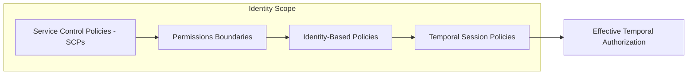

# Least Privilege Governance & IAM Permission Boundary Reference

## 1. Governance Principles

Achieving true Least Privilege in dynamic multi-tenant cloud environments requires accounting for both static authorization policies and temporal credential availability.

## 2. Enforcement Standards

1. **Mandatory Permissions Boundaries**: All dynamically created IAM roles (e.g., via Terraform, CloudFormation, or CI/CD pipelines) must possess an enterprise permission boundary.
2. **Session Policy Scoping**: Downscope STS `AssumeRole` calls using inline session policies restricting action scopes to current task context.
3. **Automated Pruning**: Graph metrics flag privileges unused for over 30 days for automated remediation.
