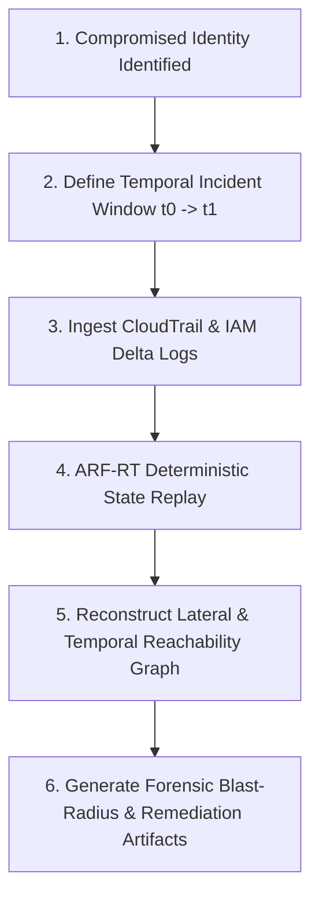

# Post-Breach Temporal Forensics & Blast-Radius Reconstruction

## 1. Executive Summary

When an IAM identity compromise occurs in a complex multi-account AWS environment, static log analysis fails to determine whether ephemeral privilege escalations or temporal role-assumption windows were leveraged by the threat actor.

The ARF-RT Temporal Engine provides deterministic historical state reconstruction, mapping precise blast radiuses and identifying dormant backdoors.

## 2. Forensic Investigation Workflow

## 3. Key Investigation Metrics

- **Maximum Escalation Horizon ($H_{max}$)**: The furthest privilege level reachable from the compromised entity during active session TTLs.
- **Cross-Account Blast Vector**: Identification of all trust relationships traversed via `sts:AssumeRole`.
- **Dormant Access Key Inception**: Detection of secondary credentials minted during temporary elevation windows.
