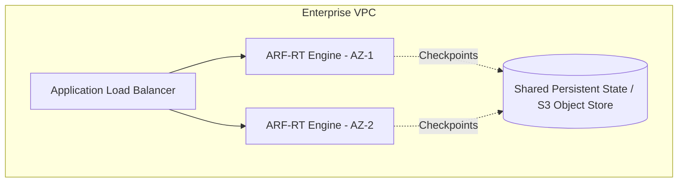

# Production Deployment & Air-Gapped Verification Guide

## 1. Overview & Architecture

ARF-RT-TEMPORAL is designed for high-assurance enterprise deployments across cloud native, hybrid, and air-gapped environments. This guide details production hardening, containerized execution, secret management, and deterministic offline verification.

## 2. Infrastructure Prerequisites

| Component | Minimum Specification | Recommended Production Spec |
| :--- | :--- | :--- |
| **Compute** | 4 vCPU, 8 GB RAM | 8 vCPU, 16 GB RAM |
| **Python Runtime** | 3.10+ | 3.11 with optimized CPython or PyPy |
| **Storage** | 50 GB SSD | 250 GB NVMe (for historical temporal graph checkpoints) |
| **Network** | Outbound HTTPS to AWS APIs | VPC Endpoints for STS, IAM, CloudTrail, EventBridge |

## 3. High Availability Architecture

## 4. Air-Gapped / Isolated Verification

For regulated federal and defense installations operating without direct internet egress:
1. **Pre-bundled Wheel Artifacts**: All dependencies are packaged via offline wheelhouses.
2. **Deterministic Artifact Checksums**: All build artifacts are verified using SHA-256 hashes against signed release manifests.
3. **Local CloudTrail Replay**: Synthetic or scrubbed CloudTrail and IAM policy snapshots are read directly from local POSIX filesystems without requiring live AWS credentials.
